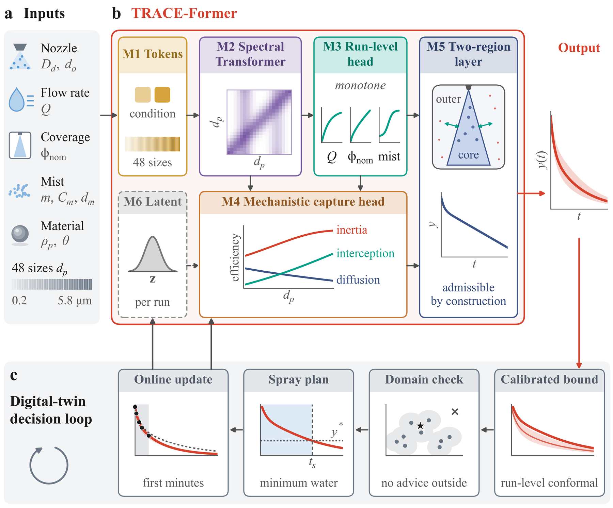
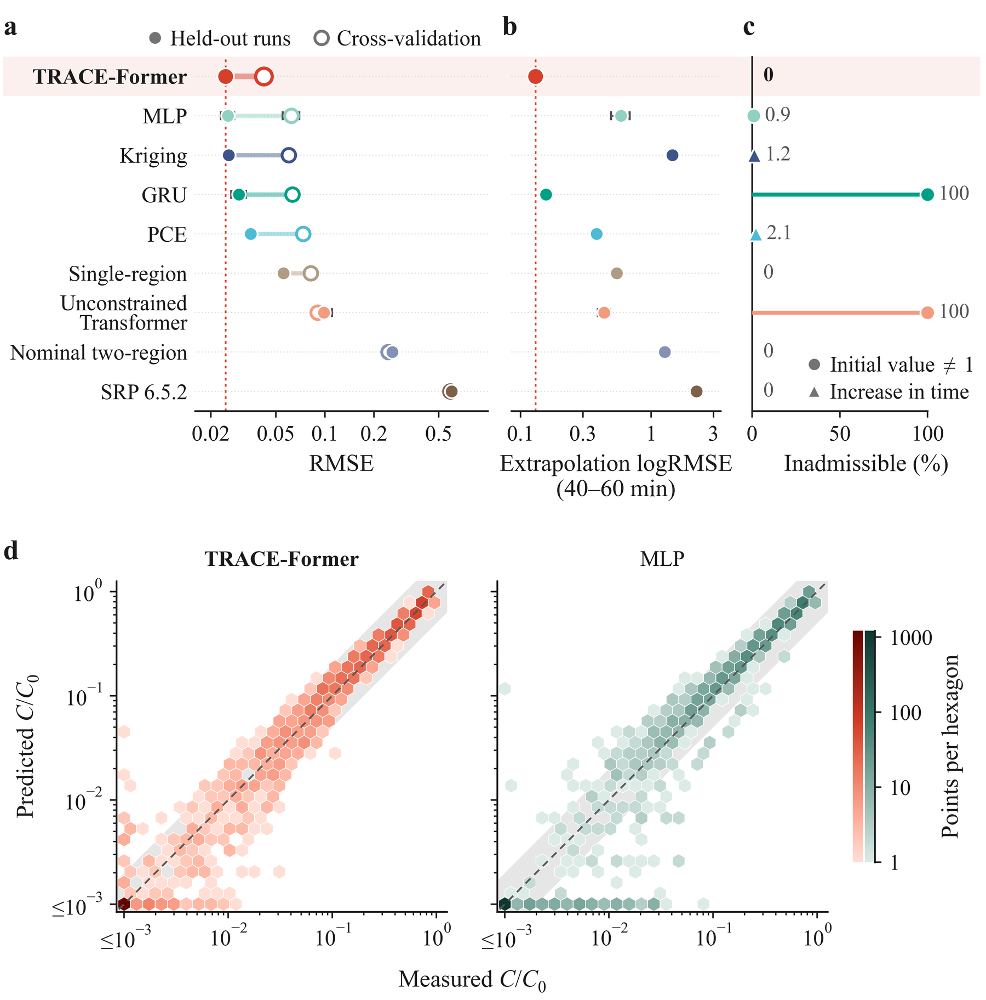
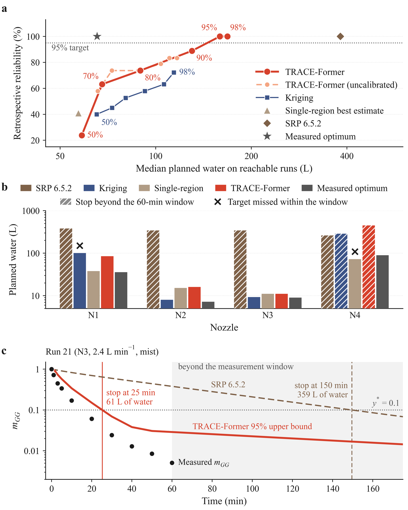
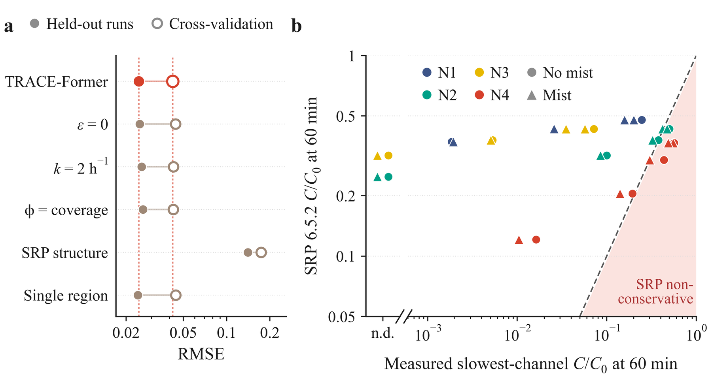

# TRACE-Former

Code and trained models of TRACE-Former, a physics-embedded neural hazard model for risk-informed water-spray planning in nuclear decommissioning.

## Overview

Water spray confines radioactive aerosols released during fuel debris retrieval, but the spray water becomes contaminated waste, so the spray duration is a safety decision under uncertainty. TRACE-Former is a physics-embedded neural hazard model that serves as the predictive core of a digital twin for spray operation. Its closed-form two-region transport–capture layer guarantees admissible decay in the parameters of the regulatory spray model, and run-level conformal calibration supports chance-constrained spray planning. With 32 size-resolved experiments, TRACE-Former reduced the cross-validation error by 30% relative to the best of eight baselines without any inadmissible trajectory. Calibrated plans for a tenfold concentration reduction reached the target in all 17 cases verifiable within 60 min and used 58% less water than the plan of Standard Review Plan (SRP) 6.5.2.



*Framework: (a) operating conditions and aerosol-size channels, (b) TRACE-Former, (c) digital-twin decision loop.*

## Highlights

- **Admissible by construction.** The closed-form two-region layer returns trajectories that start at 1, stay within [0, 1], and decay with a non-increasing hazard rate.
- **Regulatory parameters.** Predictions are expressed in two-region parameters with regulatory counterparts, which showed that removal slows after a decontamination factor of about 1.6 per particle size, far earlier than the factor of 50 in SRP 6.5.2.
- **Calibrated with runs as the units.** Run-level conformal calibration raised the reliability of 95% spray plans from 83% to 100%.
- **Less contaminated water.** Calibrated plans needed a median of 159 L of water against 382 L for SRP 6.5.2.
- **Transfer to new materials.** The mechanistic capture head carries the aerosol density and reduced the zero-shot error for SiC, CeO₂, and TiO₂ by 28% relative to the best material-blind baseline.

## Key Results



*Accuracy and physical admissibility against eight baselines on held-out runs, in cross-validation, and in temporal extrapolation.*



*Risk-informed spray planning: reliability against planned water, the selected plan of each nozzle, and an example plan against SRP 6.5.2.*



*Test of the SRP 6.5.2 assumptions: variants of TRACE-Former that impose them, and the regulatory estimate against the measured slowest channel.*

| Result | Value |
|:--|:--|
| Cross-validation RMSE / logRMSE, 26 development runs | 0.0422 / 0.259 |
| Held-out RMSE / logRMSE, six test runs | 0.0246 / 0.146 |
| Extrapolation logRMSE at 40–60 min, trained on 0–30 min | 0.130 |
| Inadmissible trajectories | 0.0% |
| Coverage of the 80/90/95% intervals, development runs out of fold | 83.2/93.8/98.8% |
| Reliability of 95% plans for the target 0.1, calibrated / uncalibrated | 17 of 17 / 15 of 18 |
| Median planned water, TRACE-Former / SRP 6.5.2 | 159 L / 382 L |
| Zero-shot RMSE, SiC / CeO₂ / TiO₂ | 0.147 / 0.050 / 0.115 |

`scripts/test.py` reproduces every value of this table from the shipped models and the data.

## Repository Structure

```
data/                           experimental data set, documentation, and examples
  aerosol_data.xlsx             final experimental data set of the paper (35 UTARTS runs)
  README.md                     column dictionary, run structure, and splits
  example/
    synthetic_aerosol_data.csv  model-generated data set in the format of the experimental data
    example_conditions.csv      eight spray scenarios for inference
scripts/                        training, reproduction, and inference
  train.py                      trains the 75 ensemble members
  test.py                       reproduces the paper results, or predicts and plans new scenarios
models/                         trained ensembles, calibration, and configuration
  trace_former_dev26.pt         10 members trained on the 26 development runs
  trace_former_cv0.pt           10 members of cross-validation fold 0 (runs 1, 2, 3, 13, 14 held out)
  trace_former_cv1.pt           10 members of fold 1 (runs 8, 9, 10, 22, 23 held out)
  trace_former_cv2.pt           10 members of fold 2 (runs 17, 18, 19, 27, 28 held out)
  trace_former_cv3.pt           10 members of fold 3 (runs 20, 21, 24, 25, 26 held out)
  trace_former_cv4.pt           10 members of fold 4 (runs 6, 7, 11, 12, 31, 32 held out)
  trace_former_all32.pt         10 members trained on all 32 ZrO2 runs
  trace_former_t30.pt           5 members trained on 0-30 min of the 26 development runs
  calibration.npz               CV+ scores, planning quantiles, and applicability domain
  config.json                   hyperparameters, size channels, splits, and model files
figures/                        framework and result figures of the paper
```

## Usage

Run all commands from the repository root.

### Requirements

Python 3.11 or newer. The scripts run on a CPU and were tested with numpy 2.4, pandas 2.3, openpyxl 3.1, and the CPU build of PyTorch 2.9. The exact versions below reproduce the original results bitwise:

```bash
pip install numpy==2.4.0 pandas==2.3.3 openpyxl==3.1.5 torch==2.9.1 --extra-index-url https://download.pytorch.org/whl/cpu
```

pip warns that numpy 2.4.0 has been yanked from PyPI. It still installs, and it is the version that reproduces the original results bitwise.

### Training

```bash
python scripts/train.py
```

The script trains the 75 members of the paper on `data/aerosol_data.xlsx` and writes `config.json` and one file `trace_former_<ensemble>.pt` per ensemble to `models/`:

- `dev26`, `cv0` to `cv4`, and `all32`: seeds 0 to 9 on the 26 development runs, on the development runs outside each cross-validation fold, and on all 32 ZrO₂ runs
- `t30`: seeds 0 to 4 on 0–30 min of the 26 development runs

A member takes 3000 full-batch steps, about 1 to 3 min with 2 threads, and the full protocol takes about 25 min with the default 8 workers. With the default 2 threads per worker, the retrained members are bitwise identical to the shipped ones. `--groups` selects ensembles (`dev26`, `cv`, `cv0` to `cv4`, `all32`, `t30`) and `--seeds` selects seeds. A partial run belongs in its own directory, given by `--out`, because a file written to `models/` replaces the shipped ensemble of its group. For example, one member of fold 2:

```bash
python scripts/train.py --groups cv2 --seeds 3 --out models_cv2
```

### Testing

```bash
python scripts/test.py
```

The script predicts the 75 members and recomputes the TRACE-Former results of the paper: accuracy, extrapolation, and admissibility (Table 5), predictive uncertainty (Table 8), spray planning for the targets 0.2, 0.1, and 0.05 (Table 9 and Appendix C), and the zero-shot prediction for new materials (Section 3.4). It reads `data/aerosol_data.xlsx`, prints 26 values next to the paper values, and writes `results.json`, `table5_accuracy.csv`, `table8_uncertainty.csv`, `table9_planning_y0.2.csv`, `table9_planning_y0.1.csv`, `table9_planning_y0.05.csv`, `zeroshot.csv`, `rate_ratios.csv`, and `paper_comparison.csv` to `results/`. With the default 2 threads, all 26 values equal the paper. The run takes about 20 s.

For retrained models, add `--models <dir> --save-calibration` and copy the written `results/calibration.npz` into `<dir>` before inference with these models.

### Inference

```bash
python scripts/test.py --predict data/example/example_conditions.csv
```

Inference needs no data and takes about 10 s for the eight example scenarios. Each row of the scenario file defines one scenario:

| Column | Meaning |
|:--|:--|
| `id` | unique scenario name |
| `nozzle` | `N1` to `N4`, or empty with `Dd_um` (droplet mean size, μm) and `orifice_mm` (orifice diameter, mm) |
| `Q_lpm` | spray flow rate (L/min) |
| `coverage` | nominal spray coverage, between 0 and 1 |
| `mist_dm_um`, `mist_Cm_cm3` | mist mean size (μm) and number concentration (cm⁻³), both 0 without mist |
| `rho_kgm3`, `contact_angle_deg` | aerosol density (kg/m³) and water contact angle (°), 5600 and 66 for ZrO₂ |
| `y_star` | optional removal target, between 0.05 and 0.2 (default 0.1) |
| `confidence` | optional confidence level, 0.5, 0.7, 0.8, 0.9, 0.95, or 0.98 (default 0.95) |

The script writes two files to `predictions/`:

- `predicted_trajectories.csv` gives C/C0 of the 48 size channels at the sampling times from 0 to 60 min with the mean, the median, and the 90% CV+ interval. It also gives the concentration m_GG of the slowest channel in the Greenfield gap between 0.2 and 1 μm with its median and its calibrated upper bound at the scenario's confidence level.
- `spray_plans.csv` gives the plan status, the stop time `t_stop_min` and water volume `water_L` of the chance-constrained plan, the SRP 6.5.2 plan, the applicability-domain distance with the nearest development run, and prior two-region parameters (`prior_*`).

Plans follow the validation of the paper:

- A plan is given only for ZrO₂ and only inside the applicability domain, where the distance `ad_distance` of the flow rate, nozzle, coverage, and mist to the nearest development run is at most `ad_threshold` = 2.10. Other scenarios receive trajectories and a `plan_status` that starts with "no plan". A nozzle other than N1 to N4 is planned like the others and flagged by `nozzle_tested`.
- The removal target must lie between 0.05 and 0.2, and the confidence level must be one of the six calibrated levels.
- For new scenarios, m_GG is the highest C/C0 among all 23 Greenfield-gap channels between 0.198 and 0.965 μm. The plans of the paper used the channels measured in each run, so a stop time for a new scenario can exceed that of a run with fewer measured channels.
- The paper validated the plans within the 60-min measurement window. A later stop time, marked by `stop_within_60min` = False, comes from the calibrated bound extended log-linearly from its values at 50 and 60 min. If the bound stays above the target for 600 min, `plan_status` reads "target not reached within 600 min" and no stop time is given.

### Example data

`data/example/synthetic_aerosol_data.csv` has the format and run structure of the experimental data set. Its values were generated by the trained models with measurement noise and are not measurements. It tests the whole pipeline in about 3 min:

```bash
python scripts/train.py --data data/example/synthetic_aerosol_data.csv --steps 300 --out models_synthetic
python scripts/test.py --data data/example/synthetic_aerosol_data.csv --models models_synthetic --out results_synthetic
```

The printed comparison then differs from the paper. `data/README.md` describes both example files.

## Data Availability

The final experimental data set of the paper is included as `data/aerosol_data.xlsx`: 35 size-resolved runs of the UTARTS facility, 32 with ZrO₂ aerosols and one each with SiC, CeO₂, and TiO₂. `data/README.md` documents its columns, run structure, and splits.

## Citation

```bibtex
@article{zhou2026traceformer,
  title   = {Physics-embedded neural hazard modeling with calibrated uncertainty for best-estimate-plus-uncertainty spray planning in nuclear decommissioning},
  author  = {Zhou, Wen and Xu, Ruicong and Miwa, Shuichiro and Wang, Hanyu and Wang, Kai and Sharma, Avadhesh Kumar and Kumar, Ravinder and Ahmed, Zeeshan and Huang, Yangkai and Nishimura, Yosuke and Yokoyama, Ryo and Suzuki, Shunichi and Okamoto, Koji},
  journal = {Reliability Engineering \& System Safety},
  year    = {2026},
  note    = {under review}
}
```

The reference will be updated after publication.
